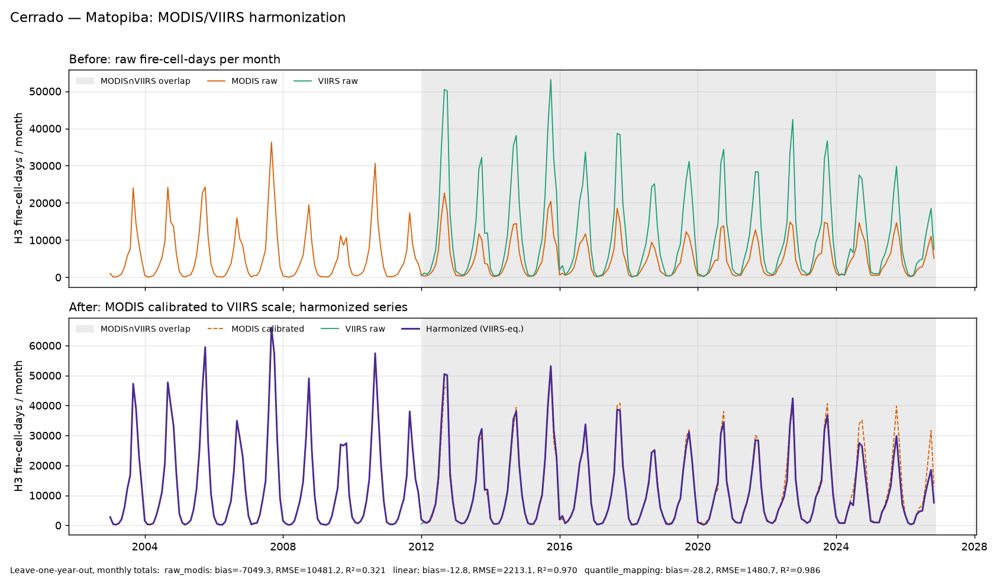
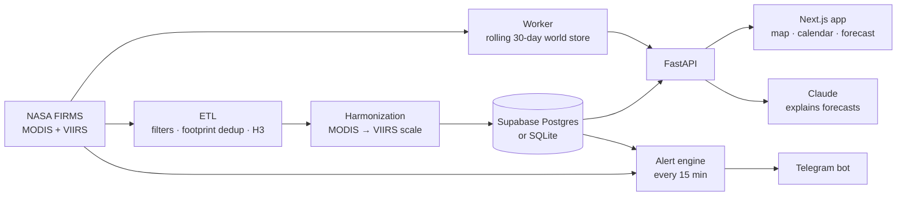

<div align="center">


# FireTrack

**One consistent, global fire record from two generations of NASA satellites — with a calendar, a 7-day risk forecast and real-time alerts for anyone on Earth.**

*NASA Space Apps Challenge 2026 · Challenge: **Harmonization of MODIS & VIIRS Hot Spots***

[Problem](#the-problem) · [Solution](#the-solution) · [Results](#verified-results) · [Quick start](#quick-start) · [Architecture](#architecture) · [Limitations](#honest-limitations) · [Team](#team)

</div>

---

## The problem

NASA has watched Earth's fires from space for more than two decades, but with **two different instruments**:

| | MODIS (Terra/Aqua) | VIIRS (Suomi NPP, NOAA-20, NOAA-21) |
|---|---|---|
| Pixel size | 1 km | 375 m |
| Record | 2000 → today | 2012 → today |
| Sees | large, intense fires | small, cool fires too |

Plot both on one chart and you get a **false jump**: fire "increases" in 2012 only because a more sensitive sensor
came online. Add the two CSVs together and the same fire is **counted twice**. Meanwhile MODIS is aging (orbit drift of
Terra/Aqua), so a long-running series is urgent — and people on the ground need alerts quickly, not a spreadsheet.

## The solution

**Harmonize before telling.** FireTrack turns the raw detections into one series that means the same thing in 2005
and in 2026, then builds tools on top of it.

```
 1 LOAD            2 GROUP               3 CALIBRATE             4 INDICATE
 MODIS + VIIRS  →  one event, one count  →  MODIS on the VIIRS  →  calendar, anomalies,
 (NASA FIRMS)      (H3 cells, footprint     scale (quantile        7-day risk, alerts
                    de-duplication)         mapping per month)
```

| Feature | What it does |
|---|---|
| **Worldwide hotspot map** | Every heat detection of the last days from MODIS + VIIRS, on a light basemap. Opens with **no filter selected**. Click a hotspot → exact coordinates, **Open in Google Maps / Satellite view**. |
| **Fire calendar (2003 → today)** | Harmonized year × month heatmap per region, with anomaly of the current month. |
| **Harmonization view** | Before/after chart and validation metrics: see the 2012 step shrink. |
| **7-day risk forecast** | Per-cell probability from a calibrated LightGBM model; for live regions a transparent persistence baseline. **Claude** explains the numbers in plain language (it never invents them). |
| **Real alerts (Telegram)** | Anyone in the world signs up with an international phone number and a confirmed address; firefighters register a city. A single FIRMS query every 15 min covers all recipients. |
| **For teachers** | World map, concepts, three lesson plans (Geography, Science, Statistics), glossary, CSV downloads. |
| **Open data** | Filtered CSV export, documented REST API (OpenAPI at `/docs`). |

The interface is in **English** and works for any country: country-aware emergency numbers, UTC timestamps, worldwide address search.

## Verified results

All numbers below come from the repository's own runs (`docs/METHODOLOGY.md`, `data/processed/matopiba/ml_metrics.json`),
region **Cerrado — Matopiba** (Brazil), real FIRMS data, 2003-01-01 → 2026-11-15.

| | |
|---|---|
| Raw detections processed | **14,095,506** (6 FIRMS products) |
| After quality filters + static-source mask + cross-satellite de-duplication | 8,828,648 |
| Active H3 cell-days (res. 6) | 3,485,995 |
| Harmonization validation | leave-one-year-out, 2012–2023 (4,364 overlap days) |
| **Monthly R², MODIS → VIIRS scale** | **0.986** (raw MODIS: 0.32) |
| Monthly RMSE | 1,481 fire-cell-days (raw: 10,481) |
| Daily R² | 0.76 |



**Risk model** (temporal split: train ≤ 2019, validation 2020–22 for tuning and calibration, **test 2023–26**, never seen):

| Model (P ≥1 fire in the cell in the next 7 days) | ROC-AUC | PR-AUC | Brier | Top-10 % capture |
|---|---|---|---|---|
| **LightGBM + isotonic calibration** | **0.872** | **0.359** | **0.0425** | **54.7 %** |
| Climatology baseline | 0.822 | 0.245 | 0.0471 | 45.1 % |
| Persistence baseline | 0.644 | 0.171 | 0.0502 | 33.6 % |

The model beats both baselines in every test year (PR-AUC 2023–2026: 0.38 / 0.37 / 0.35 / 0.31) and its calibration
error is 0.26 %. The README reports the weakening in 2026 instead of hiding it.

## Honest limitations

We treat these as part of the result, not as footnotes.

1. **A hotspot is not a fire.** It is a thermal anomaly seen at the moment of a satellite pass. It can be a controlled burn, industry, or miss a fire under cloud or smoke.
2. **Harmonization reduces the step, it does not erase it.** It assumes a stable MODIS↔VIIRS relationship per month. Daily R² (0.76) is far lower than monthly (0.986); in transition months (Mar–Apr) the per-month fit is weak. Before 2012 the uncertainty is higher.
3. **MODIS is aging.** Outside the 2012–2023 fitting window the calibrated series over-predicts VIIRS by about 25–40 % (orbit-drift signature) — which is exactly why the harmonized series matters.
4. **Full history exists for one region.** Cerrado — Matopiba has the 2003 → today calendar, harmonization and per-cell forecast. Other regions are monitored **live** (recent days of NASA FIRMS) with a baseline forecast; their historical series are not loaded yet and the app does not pretend otherwise.
5. **The forecast uses fire history only** — no rain, humidity or wind. It is a screening tool, not an operational prediction.
6. **The LLM does not predict.** Probabilities come from the statistical model; Claude only interprets them, with a prompt that forbids inventing numbers.
7. Non-Brazilian emergency numbers in the app were compiled from public lists and **need local verification**.

## Architecture



| Layer | Stack |
|---|---|
| Data | NASA FIRMS Area API (MODIS C6.1, VIIRS SNPP/NOAA-20/NOAA-21, standard + NRT) |
| ETL | Python 3.11+, pandas, **H3** (res. 6), reproducible and incremental; Apache Hop pipelines included |
| Harmonization | Quantile mapping per month, leave-one-year-out validation |
| Storage | Supabase/Postgres (row-level security, retention windows) · SQLite fallback · local parquet |
| ML | LightGBM, isotonic calibration, strict temporal split |
| API | FastAPI + Pydantic, CSV export, OpenAPI docs |
| Web | Next.js 16 · React 19 · Tailwind 4 · TanStack Query · react-leaflet (installable PWA) |
| Alerts | Telegram long-polling bot, Nominatim geocoding, E.164 phone validation |
| AI | Claude (server-side only) for plain-language interpretation |

More detail: [docs/METHODOLOGY.md](docs/METHODOLOGY.md) · [docs/DATA_DICTIONARY.md](docs/DATA_DICTIONARY.md) · [docs/PLAN.md](docs/PLAN.md) · [docs/APRESENTACAO.md](docs/APRESENTACAO.md)

## Quick start

Requirements: Python 3.11+, Node 20+. Docker is optional (SQLite fallback).

```bash
python tasks.py setup      # venv + dependencies + .env
python tasks.py etl        # FIRMS -> H3 -> harmonization -> DB   (needs FIRMS_MAP_KEY)
python tasks.py train      # 7-day risk model + metrics vs baselines
python tasks.py forecast   # writes risk_forecasts
python tasks.py api        # http://localhost:8000/docs   (API_PORT)
python tasks.py web        # http://localhost:3000
python tasks.py worker     # keeps a rolling 30-day worldwide store fresh (optional)
python tasks.py bot        # Telegram alerts (needs TELEGRAM_BOT_TOKEN)
python tasks.py test       # 41 backend tests;  cd web && npm test  (9 front-end tests)
```

No keys yet? `data/sample/` is **synthetic** (clearly labeled) so the whole pipeline runs offline.

### Environment (`.env`, never committed)

| Variable | Purpose |
|---|---|
| `FIRMS_MAP_KEY` | NASA FIRMS key — free at <https://firms.modaps.eosdis.nasa.gov/api/area/> |
| `DB_BACKEND`, `DATABASE_URL`, `SQLITE_PATH` | `supabase` \| `postgres` \| `sqlite` (Supabase **session pooler**, port 5432) |
| `ANTHROPIC_API_KEY`, `ANTHROPIC_MODEL` | Server-side only, for `/forecast/insight` |
| `TELEGRAM_BOT_TOKEN`, `APP_PUBLIC_URL` | Alerts; the public URL must be reachable from the user's phone |
| `API_CORS_ORIGINS`, `API_PORT`, `REGION` | API settings; the web app reads `NEXT_PUBLIC_API_URL` from `web/.env.local` |

### Main API routes

`/meta` · `/world` · `/live` · `/recent` · `/calendar` · `/summary` · `/hexgrid` · `/harmonization` · `/comparison` ·
`/forecast` · `/forecast/live` · `/forecast/insight` · `/export.csv` · `/glossary` · `/alerts/*`

## Sustainable Development Goals

| SDG | How FireTrack contributes |
|---|---|
| **13 · 15** Climate action · Life on land | Monitor fire patterns and anomalies by region, year and season |
| **4** Quality education | Teachers' page and lesson plans that teach how to question data |
| **11 · 3** Safe cities · Health | Alerts to residents and firefighters near a detected hotspot |
| **17** Partnerships | Open NASA data, open API, CSV export for everyone |

## Safety, privacy and responsible AI

- Alerts are informational: **in an emergency call your local emergency number** (the app shows the right one per country).
- Personal data (name, phone, age, address, Telegram) is stored only to send alerts, protected by row-level security with no public policies; `/stop` in the bot deletes the registration and its history. Minors need a guardian's authorization.
- Secrets live only in `.env` (git-ignored); the Anthropic key never reaches the browser.
- **AI disclosure:** the base layout of the presentation was drafted with Claude; project information was gathered with the help of ChatGPT; the application code was developed with Claude Code, and Claude is used at runtime to explain forecasts. Every reported metric was computed by the project's own code and is reproducible.

## Team

**AstroS Team** — Brazil

| Name | Role |
|---|---|
| Fabricya Nayanne Santos | Front-end developer, web developer |
| Gyan Luka Souza Santos | Graphic designer |
| João Victor do Nascimento Silva | Web developer, security researcher |
| Lucas Gabriel Aguiar Monteiro | Researcher, translator, UX/UI developer |
| Manoel Dantas Macedo Filho | Researcher, UI/UX designer, web developer |
| Maria Eduarda dos Santos Fontes Silva | Graphic designer |

## Data and acknowledgements

This project uses data from NASA's **Fire Information for Resource Management System (FIRMS)**, part of NASA
LANCE and ESDIS — <https://earthdata.nasa.gov/firms>. Basemap © OpenStreetMap contributors © CARTO. Place search by
OpenStreetMap Nominatim. Built for the **NASA International Space Apps Challenge**; this is an independent
participant project and is not endorsed by NASA.
