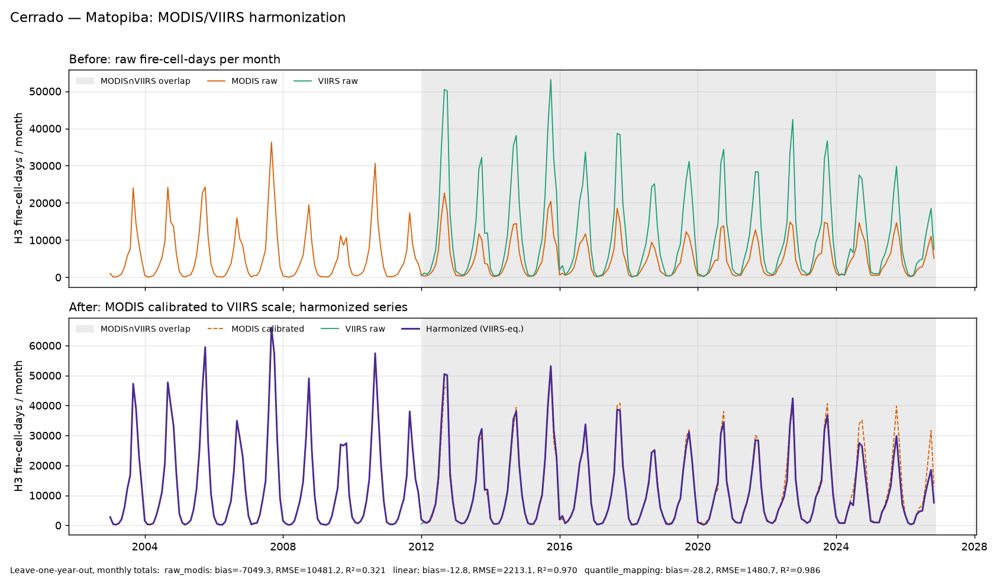
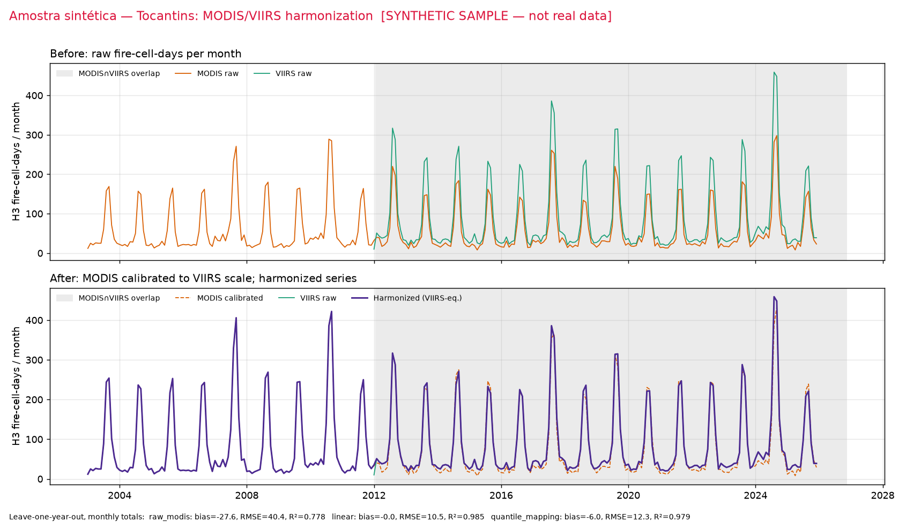

# Methodology (draft — end of Phase 1, 2026-11-14)

## 1. Problem
MODIS (Terra 2000+, Aqua 2002+, 1 km) and VIIRS (SNPP 2012+, NOAA-20 2018+, NOAA-21 2023+,
375 m) both detect active fires, but VIIRS sees many more, smaller fires and splits one fire into
more pixels. Raw hotspot counts therefore jump when VIIRS enters the record, and a naïve
"MODIS before 2012, VIIRS after" series is inconsistent. We want one series on a single scale for
2003–today.

## 2. Pipeline summary
1. **Normalize** MODIS/VIIRS (archive, SP and NRT) into a common schema (DATA_DICTIONARY §2).
2. **Quality filters:** drop low confidence (MODIS <30, VIIRS `l`), FIRMS `type` 1/2/3 (volcano,
   static land source, offshore), NRT detections at locations repeatedly flagged static in SP data,
   exact duplicates.
3. **Grid:** assign H3 cells (res 6, ≈36 km², configurable).
4. **Cross-satellite dedup:** within each family and day, detections in the same footprint
   (MODIS ≈1 km, VIIRS ≈375 m; 4 half-shifted grids to avoid edge splits) are counted once, so
   Terra+Aqua or SNPP+NOAA-20 seeing the same fire do not double count.
5. **Fire-cell-days (FCD):** a cell-day is "on fire" for a family if it has ≥1 detection. Counting
   cells instead of pixels removes most of the pixel-size effect (one fire = one cell-day for both
   sensors) and the satellite-count effect (two satellites seeing the same fire = one cell-day).
6. **Calibration** of MODIS FCD to the VIIRS scale (below).
7. **Monthly statistics:** totals, percentile and z-score vs the same calendar month in other
   complete years (computed on FCD per observed day, so partial months are comparable).

## 3. Calibration
Daily regional series on overlap days (both families observing):
`M_d` = MODIS FCD (Terra ∪ Aqua), `V_d` = VIIRS FCD of the **reference satellite** (below).

### 3.1 One VIIRS satellite as reference (constellation effect)
Measured on Matopiba: SNPP-only FCD / MODIS FCD is stable at 2.3–2.6 for 2012–2023, NOAA-20/SNPP
FCD is 0.98–1.07 every year 2018–2025, but the **union** SNPP ∪ NOAA-20 jumps ~1.5× when NOAA-20
starts (2018). Using "all VIIRS" would put an artificial step in the series. So `V_d` uses one
satellite per day, first available in `[SNPP, NOAA20, NOAA21]`: SNPP for 2012-01-20 → 2026-07-31
(SP), NOAA-20 afterwards (NRT). NOAA-21 is never the reference while NOAA-20 is available.
`viirs_count` in `daily_cell_counts` still reports all VIIRS detections for information.

### 3.2 Calibration window (MODIS orbit drift)
Median daytime overpass measured from the detections: Aqua 16:45 UTC (2015–2021) → 16:57 (2023) →
17:25 (2024) → 17:59 (2025) → 18:45 (2026); Terra 13:35 → 11:47 UTC. VIIRS SNPP/NOAA-20 stay at
~16:40. Over the same years V/M falls from ~2.4 to ~1.9, i.e. drifting MODIS detects relatively
more fire (Aqua moves towards the afternoon fire peak — consistent with, not proof of, the cause).
Since the series we need to harmonize is pre-2012 MODIS (nominal orbits), the mapping is fitted
on **2012–2023 only** (`calibration_years`); 2024+ is reported as an out-of-window diagnostic.
The harmonized series is not affected in 2024+, because VIIRS is used directly there.

Residual differences after the FCD step come from VIIRS Residual differences after the FCD step come from VIIRS
detecting smaller/cooler fires that MODIS misses, which is strongly seasonal, hence one mapping per
calendar month `f_m`.

- **Quantile mapping (default):** `f_m(x) = Q_V(F_M(x))`, with `F_M` the mid-rank empirical CDF of
  MODIS on that month's overlap days (handles the many zero days) and `Q_V` the empirical VIIRS
  quantile; ratio extrapolation above the training maximum.
- **Linear (baseline):** OLS `V = a + b·M` per month, clipped at 0.
- **Raw MODIS:** no calibration, reported as the reference to beat.

Harmonized series: `H_d = V_d` when VIIRS observes, otherwise `f_m(M_d)`. At cell level, the
MODIS-only era gets `modis_fire × f_m(M_d)/M_d` so cells add up to the calibrated regional value;
days with `M_d = 0` but `f_m(0) > 0` cannot be placed on cells (the share is logged as
"unplaced mass").

Coverage is product-based: days between products (e.g. a gap between SP and NRT) are treated as
unobserved, never as zero fire.

## 4. Validation
**Leave-one-year-out (LOYO)** over every overlap year: fit on all other overlap years, predict the
held-out year from MODIS only, compare with VIIRS. Metrics: bias (pred − obs), RMSE, R², at daily
and monthly aggregation, plus per-year and per-month breakdowns (`calibration_metrics`).

Unit test: synthetic data with a known factor (VIIRS = 2.5 × MODIS) must be recovered
(bias < 2 % of the monthly mean, R² > 0.99) — passes for both methods.

### Results — Matopiba (real FIRMS data, run 2026-11-14)
Input: 14,095,506 detections (MODIS_SP 3.11 M, VIIRS_SNPP_SP 7.02 M, VIIRS_NOAA20_SP 3.51 M,
MODIS_NRT 49 k, VIIRS_NOAA20_NRT 203 k, VIIRS_NOAA21_NRT 196 k), 2003-01-01 → 2026-11-14.
After filters: 12,748,870 (confidence) → 12,698,833 (static: 1,007 masked 0.01° cells) →
8,828,648 after cross-satellite footprint dedup. 3,485,995 active cell-days (H3 res 6).

Leave-one-year-out on 2012–2023 (4,364 overlap days, 144 months):

| method | daily bias | daily RMSE | daily R² | monthly bias | monthly RMSE | monthly R² |
|---|---|---|---|---|---|---|
| raw MODIS (no calibration) | −232.6 | 403.9 | 0.32 | −7,049 | 10,481 | 0.32 |
| linear per month | −0.4 | 221.8 | 0.80 | −12.8 | 2,213 | 0.97 |
| **quantile mapping per month** | −0.9 | 240.2 | 0.76 | −28.2 | **1,481** | **0.986** |

Units: fire-cell-days per day (daily) or per month (monthly). A typical peak month has 30–50 k FCD.
Quantile mapping is slightly worse than linear day-by-day but clearly better on monthly totals
(what the calendar shows), so it is the default. Per-year LOYO bias (QM, FCD/day): between −46
(2012) and +31 (2023); 2013–2022 within ±15.

Out-of-window diagnostic (model fitted on 2012–2023): calibrated MODIS over-predicts VIIRS by
+91 (2024), +94 (2025), +100 (2026) FCD/day ≈ +25–40 %, the orbit-drift signature above.

Sanity check on the latest season: Aug–Oct 2026 has the 2nd-lowest raw MODIS FCD of 2003–2026
(only 2018 is lower), so a weak 2026 season is corroborated by an independent sensor. Its
harmonized percentile (0) is likely exaggerated: the 2026 tail is NOAA-20 **NRT** and its V/M
(1.77) is even below 2024–25.

### Results — synthetic sample (pipeline check only, NOT real data)
| method | daily RMSE | daily R² | monthly bias | monthly RMSE | monthly R² |
|---|---|---|---|---|---|
| raw MODIS | 2.37 | 0.64 | −35.4 | 54.5 | 0.70 |
| linear | 1.72 | 0.81 | −0.2 | 22.5 | 0.95 |
| quantile mapping | 1.85 | 0.78 | −2.8 | 20.7 | 0.96 |

## 5. Limitations (running list)
- The VIIRS reference switches from SNPP (SP) to NOAA-20 (NRT) on 2026-08-01. NOAA-20/SNPP ≈ 1 in
  SP data, but NRT vs SP equivalence for the tail is not yet verified.
- MODIS Terra/Aqua orbit drift (2022+) changes MODIS sensitivity; handled by the calibration window,
  not modelled. MODIS-only harmonization of 2024+ would be biased high (+25–40 %).
- Pre-2012 MODIS is assumed to behave like 2012–2023 MODIS (same instruments, nominal orbits).
- NRT and SP products are not identical (NRT is later replaced by SP); the tail of the series is
  NRT and will change slightly when reprocessed.
- Cloud cover and smoke reduce detection for both sensors on the same days; calibration cannot
  recover fires neither sensor saw.
- Calibration is fitted per region; transferring it to another biome requires refitting.
